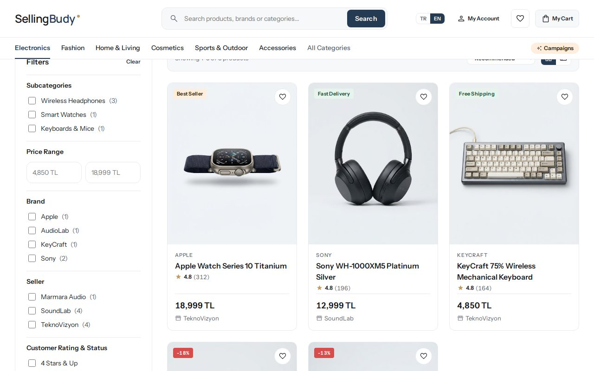
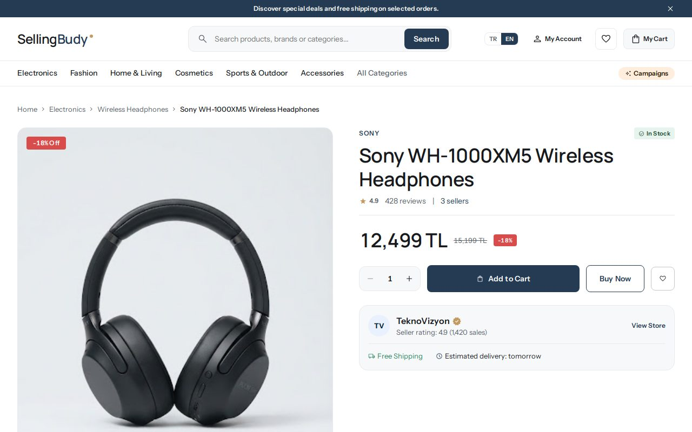
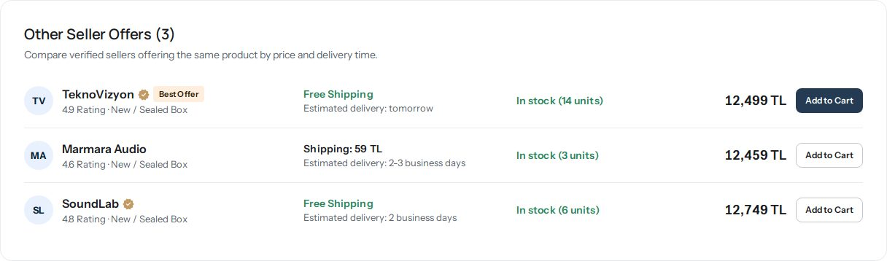
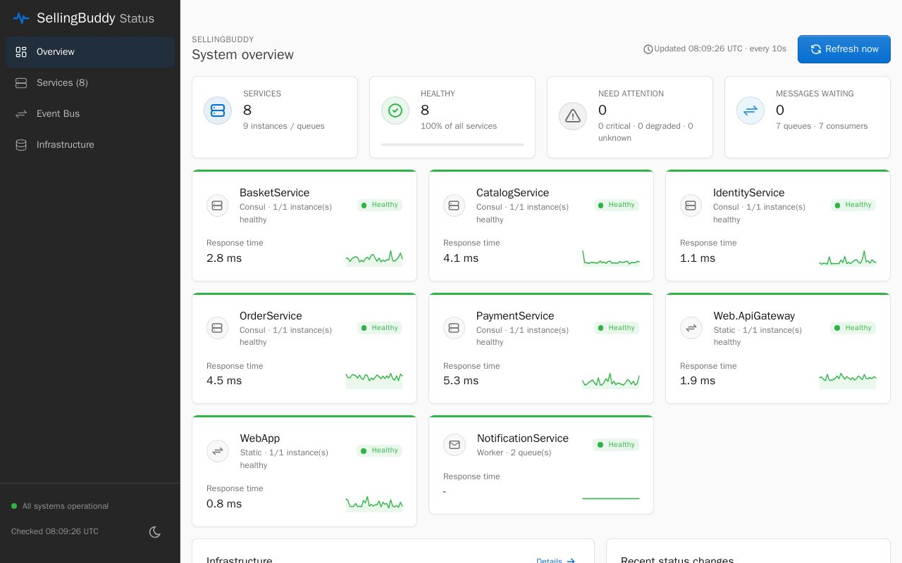
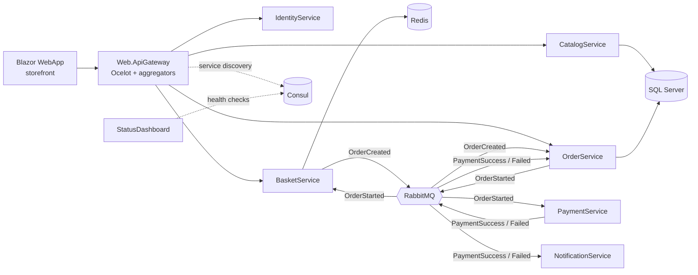

# SellingBuddy

A multi-vendor e-commerce sample built with **.NET 10 microservices**. Several sellers can offer the
same product, customers compare offers, add the one they want to the cart and check out. Behind
the storefront, services talk through an **API gateway** for synchronous calls and a
**RabbitMQ event bus** for everything asynchronous.


## Highlights

- **Microservices**: Catalog, Identity, Basket, Order, Payment and Notification. Each service
  owns its own data, and services never reference each other's projects.
- **API gateway**: Ocelot with Consul service discovery, plus aggregator endpoints, for example
  adding an item to the basket with the price taken from the catalog offer.
- **Event bus**: a custom abstraction with RabbitMQ and Azure Service Bus implementations, so the
  checkout flow runs on integration events.
- **DDD + CQRS** in OrderService: aggregates, value objects, domain events and MediatR commands
  and queries.
- **Multi-vendor catalog**: sellers, per-seller offers (price, stock, shipping fee, delivery
  time), categories with subcategories, specs, reviews, campaigns, facets and filters.
- **Bilingual storefront (TR / EN)**: a Blazor Web App storefront with UI text from resx files.
  Catalog content follows `Accept-Language`, while customer reviews stay in the language they
  were written in.
- **Status dashboard**: a TabBlazor app showing service health, response times, queues and
  infrastructure.
- **Docker Compose** runs the whole system with one command.

## Screenshots

| Category listing | Product detail |
|---|---|
|  |  |

| Seller offers | Mobile |
|---|---|
|  |  |



## Architecture



### Checkout flow

1. The WebApp calls `POST basket/checkout` through the gateway. BasketService creates the order
   id, calculates shipping (standard shipping is charged per seller, same day is a flat fee) and
   publishes `OrderCreatedIntegrationEvent`.
2. OrderService creates the order with its items and sellers, then publishes
   `OrderStartedIntegrationEvent`.
3. BasketService clears the basket and PaymentService charges the order.
4. PaymentService publishes `OrderPaymentSuccess` or `OrderPaymentFailed`. OrderService marks the
   order as paid or cancelled, and NotificationService informs the customer.

## Tech stack

| Area | Technology |
|---|---|
| Runtime | .NET 10, ASP.NET Core, Blazor Web App (interactive server) |
| Gateway | Ocelot 24, Ocelot.Provider.Consul |
| Messaging | RabbitMQ.Client 7, Azure Service Bus (optional), Polly |
| Data | EF Core 10 + SQL Server, StackExchange.Redis |
| Patterns | DDD, CQRS with MediatR, integration events |
| Discovery and health | Consul, ASP.NET Core health checks |
| Logging | Serilog |
| Monitoring UI | TabBlazor |
| Containers | Docker Compose |

## Project structure

```
src/
  ApiGateways/WebApiGateway/Web.ApiGateway      Ocelot gateway and aggregator endpoints
  BuildingBlocks/EventBus                       EventBus.Base, RabbitMQ, AzureServiceBus, Factory, UnitTest
  BuildingBlocks/HealthChecks                   shared /health response format
  Clients/BlazorWebApp/WebApp                   storefront (TR / EN)
  Monitoring/StatusDashboard                    service status dashboard
  Services/CatalogService                       products, sellers, offers, categories, campaigns, reviews
  Services/IdentityService                      JWT login (demo users)
  Services/BasketService                        basket, wishlist, checkout (Redis)
  Services/OrderService                         Api / Application / Domain / Infrastructure (DDD + CQRS)
  Services/PaymentService                       payment simulation
  Services/NotificationService                  console worker consuming payment events
```

## Getting started

### Requirements

- Docker Desktop
- .NET 10 SDK (only if you want to run services outside containers)

### Run everything in Docker

```bash
git clone https://github.com/YavuzMuhammetAli/SellingBuddy.git
cd SellingBuddy
docker compose up -d --build
```

Then open the storefront at http://localhost:5198 and sign in with a demo account.

| User | Password |
|---|---|
| `demo@sellingbuddy.dev` | `demo123` |
| `admin@sellingbuddy.dev` | `admin123` |

Databases are migrated and seeded automatically when the services start.

### Run services locally

```bash
docker compose up -d sqlserver redis rabbitmq consul    # infrastructure only
dotnet tool restore
dotnet build SellingBuddy.slnx
dotnet run --project src/Services/CatalogService/CatalogService.Api
```

### Tests

```bash
dotnet test src/BuildingBlocks/EventBus/EventBus.UnitTest
```

## URLs and ports

| App | URL |
|---|---|
| Storefront (WebApp) | http://localhost:5198 |
| API gateway | http://localhost:5131 |
| Status dashboard | http://localhost:5300 |
| CatalogService | http://localhost:5140 |
| IdentityService | http://localhost:5095 |
| BasketService | http://localhost:5166 |
| OrderService | http://localhost:5226 |
| PaymentService | http://localhost:5278 |
| RabbitMQ management | http://localhost:15672 (guest / guest) |
| Consul | http://localhost:8500 |
| SQL Server | `localhost,1435` |
| Redis | `localhost:6389` |

SQL Server and Redis use non-default host ports so they don't clash with local instances.

## Known limitations

This is a learning and portfolio project, so some features are only on the UI side:

- Identity only has demo users. Register, forgot password and reset password pages validate
  input but don't create users or send email.
- Payment is simulated, and there is no real delivery tracking, so orders stay "preparing" after
  payment.
- Coupons, newsletter, store follow, saved addresses and saved payment methods are shown as
  "coming soon".
- Products have a single image and no variants (color / size).

## Contributing

The repository includes agent skills (`.claude/skills`, `.agents/skills`) and `CLAUDE.md` /
`AGENTS.md`, which describe the architecture, naming and comment rules. The main rules:

- English only in code. Turkish text is allowed only in `*.tr.resx` and the catalog seed data.
- Short lowercase comments such as `//consul registration added`.
- Conventional commits: `feat(scope): ...`, `fix(scope): ...`, `docs: ...`.
